  
  
  
  

I do **applied AI research**: training small, specialised models that run on-device and outperform general frontier models on narrow security problems. I also build the platforms AI agents run on, and work on **IPFS** and content-addressed storage at petabyte scale.

🖥️ My site is a tiny desktop with a terminal. Go to **[lucasespindola.com](https://lucasespindola.com)** and type `help`.

## 🔬 Research

### [Llama-Doorman-22M](https://huggingface.co/PinataCloud/Llama-Doorman-22M)

An on-device prompt-injection classifier (22M params, ONNX int8) that tells an instruction aimed at an AI agent apart from text that only *quotes* an attack, such as test fixtures, docs and datasets. Nothing the agent reads leaves the laptop.

|                                                        | **Llama-Doorman-22M** | Best frontier model | Stock Prompt Guard 2 |
| ------------------------------------------------------ | --------------------- | ------------------- | -------------------- |
| Attacks the rules missed, caught (at 0.4% false alarms) | **79%**               | 38%                 | 5%                   |
| False alarms cleared                                   | **77.7%**             | 54.2%               | 1.8%                 |
| Time per check                                         | **~0.24 s, on-device** | 1.6 s, cloud        | ~0.24 s, on-device   |

📝 [How we trained a small model to tell a prompt injection from a quote](https://pinata.cloud/blog/how-we-trained-a-small-model-to-tell-a-prompt-injection-from-a-quote/) · 🤗 [Model card & full benchmark](https://huggingface.co/PinataCloud/Llama-Doorman-22M) · 🛡️ [Doorman](https://github.com/PinataCloud/doorman)

### Federated Content Routing

*A Three-Tier Architecture for Resilient Content Routing in IPFS*. IEEE ICC 2026, sole author and presenter. [Read the paper →](https://ieeexplore.ieee.org/document/11586836)

An edge query plane, a regional Byzantine-fault-tolerant control plane and a global DHT fallback, addressing the performance–resilience trade-off in decentralized content routing.

## 🛠️ Building

- 🛡️ **[Doorman](https://github.com/PinataCloud/doorman)**: a local-first monitor and guard for AI coding agents
- 🤖 **Persistent, stateful AI agents**: orchestration, edge networking, workspace snapshots ([OpenClaw](https://github.com/lukax/openclaw-agent-template) and [Hermes](https://github.com/lukax/hermes-agent-template) templates)
- 🌐 **Content-addressed storage** (IPFS) at petabyte scale

## 🧰 Toolbox

**ML** `fine-tuning` `evaluation & benchmarking` `ONNX` `int8 quantization` `WebAssembly inference` 
**Platform** `Kubernetes` `Terraform` `ArgoCD` `AWS` `GCP` `Cloudflare Workers` `IPFS` 
**Code** `TypeScript` `Go` `C#` `Node.js` `GraphQL` `gRPC`

## 🏆 Elsewhere

Hackathon judge at **HackMIT 2025** and **Hacktech 2026**.
